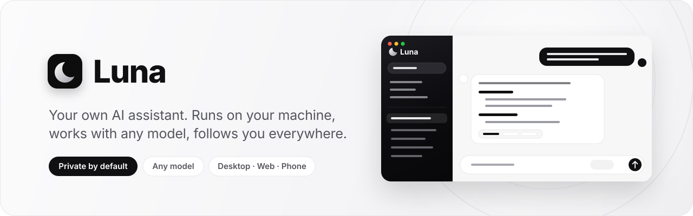
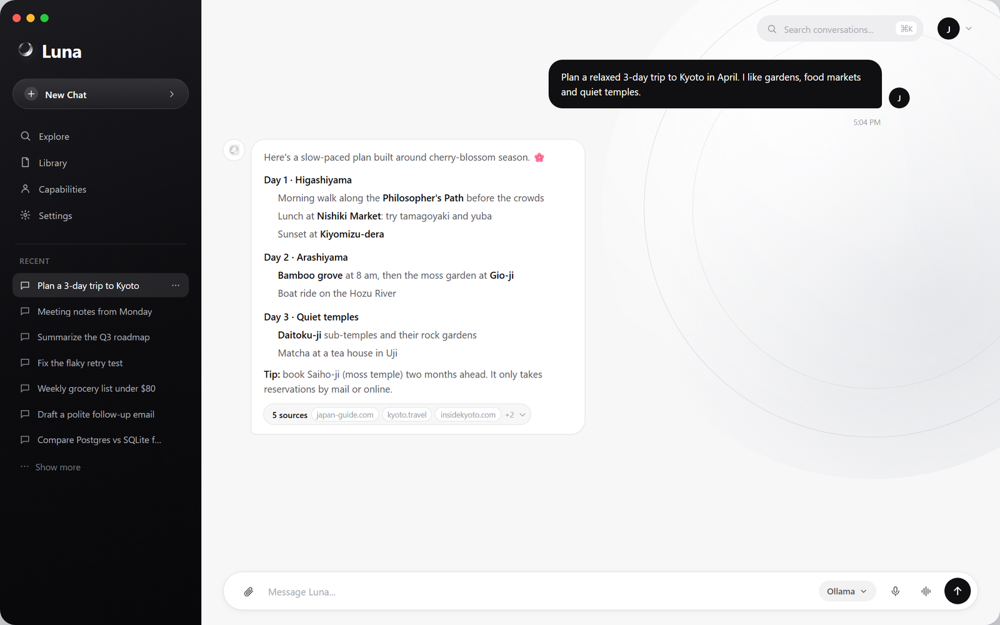
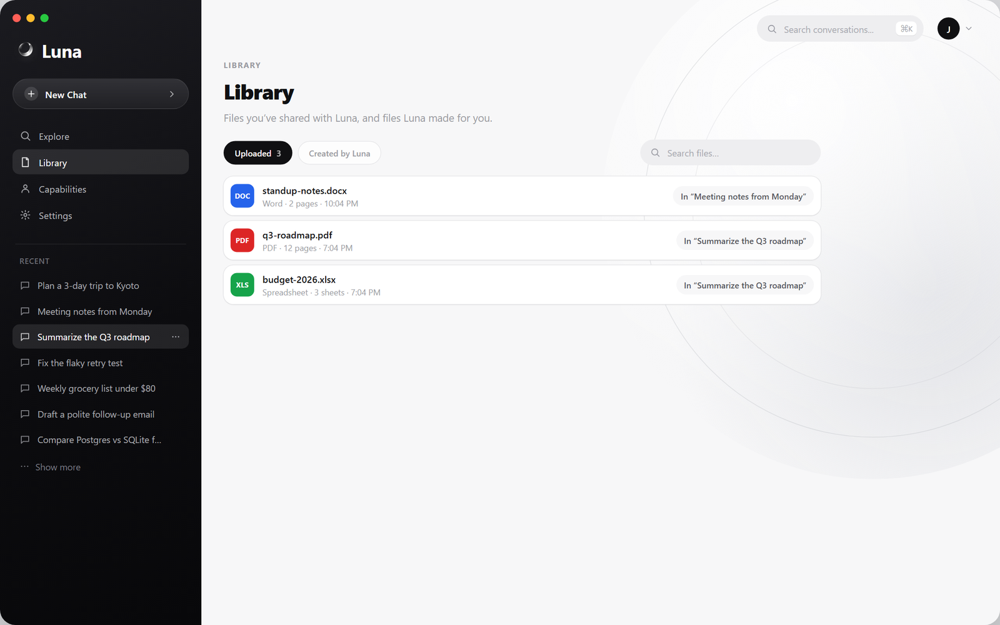
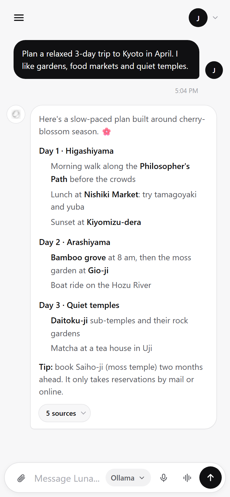
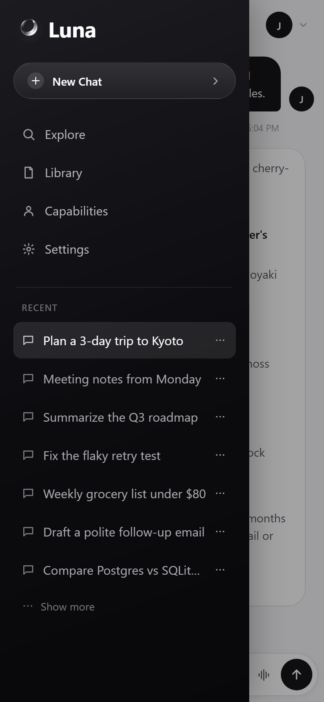
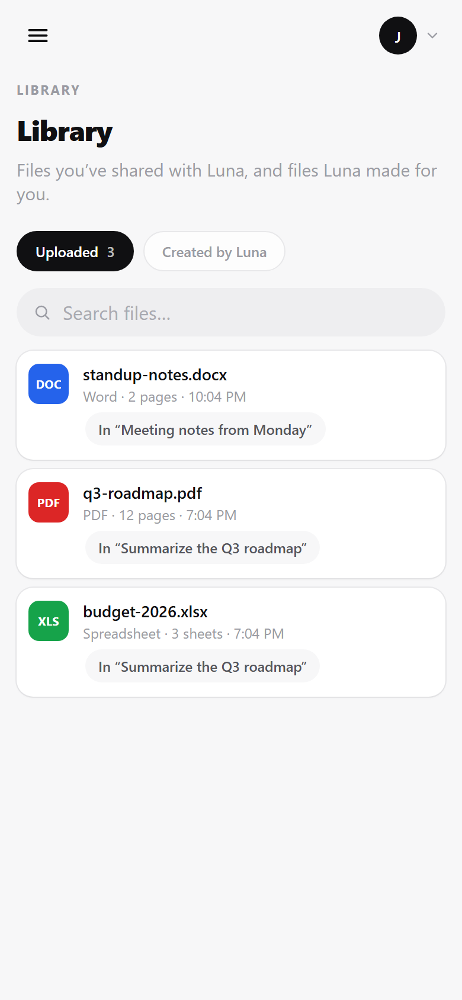
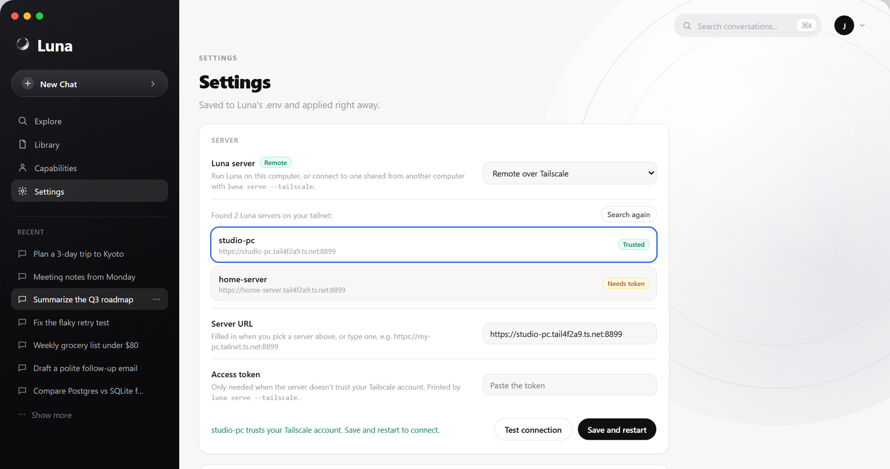
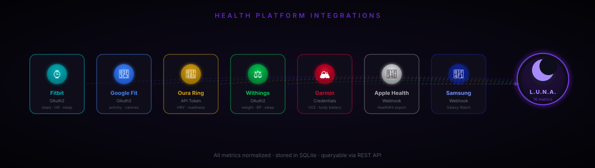

<div align="center">
  

  <h3>Your own AI assistant. It runs on your machine, works with any model, and follows you to every device.</h3>

  <p>
    <a href="https://github.com/Sehastrajit-S/Luna/stargazers"></a>
    <a href="LICENSE"></a>
    <a href="https://github.com/Sehastrajit-S/Luna/commits/main"></a>
  </p>

  <p>
    <a href="#quick-start"><b>Quick start</b></a> ·
    <a href="#a-quick-tour"><b>Tour</b></a> ·
    <a href="docs/REMOTE.md"><b>Use it anywhere</b></a> ·
    <a href="server/skills/README.md"><b>Write a skill</b></a> ·
    <a href="CONTRIBUTING.md"><b>Contribute</b></a>
  </p>
</div>

<p align="center">
  
</p>

Luna is an open-source, local-first AI assistant. Chat with it, hand it your files, let it search the web and write documents, and keep everything on hardware you own. It runs with Ollama out of the box, or with any cloud model you choose.

- **Private by default.** Inference runs locally through Ollama. Memory, chats and files stay in your own SQLite database.
- **Any model.** One line in `.env` switches between Ollama, Claude, Gemini, Groq, Mistral, Cohere, NVIDIA NIM or any OpenAI-compatible endpoint.
- **Remembers you.** Facts and preferences carry over between conversations.
- **Works with your files.** Attach PDFs, Word, Excel, slides, images or code. Everything you share, and everything Luna makes, lands in the Library.
- **Extend it in plain text.** A skill is a folder with a short JSON file and a Markdown file. No Python needed.
- **Everywhere you are.** Desktop app, browser and phone. Reach your own Luna from anywhere over Tailscale, with no ports opened to the internet.

## Quick start

Requires Node.js 18+, Python 3.10+ and [Ollama](https://ollama.com) (or an API key for a cloud model).

```bash
git clone https://github.com/Sehastrajit-S/Luna.git && cd Luna
npm install
npm run setup             # picks a model, installs dependencies, writes .env
npm run web               # opens Luna at http://localhost:8899
```

Prefer an app? Run `npm --prefix interfaces/desktop start`, or build a Windows installer with `npm run build:desktop`.

## A quick tour

### Chat with your files

Drop in a PDF, spreadsheet or slide deck and ask about it. Luna reads the text, keeps the file with the conversation, and can refer back to it later.


### Library

Every file you've shared and every file Luna created, such as reports, datasets and code, in one searchable place, each linked back to its chat.



### On your phone

The same Luna in your phone's browser. The layout adapts on its own, and you can add it to your home screen.

<table>
  <tr>
    <td align="center"></td>
    <td align="center"></td>
    <td align="center"></td>
  </tr>
</table>

### Use it from anywhere

Run Luna on your desktop and use it from your laptop or phone anywhere, privately, over [Tailscale](https://tailscale.com):

```bash
npm run serve:tailscale   # shares https://<your-pc>.<tailnet>.ts.net:8899 with your devices only
```

The desktop app finds shared Luna servers on your tailnet. Devices signed in to your own Tailscale account connect with one click and no token. Anyone else needs the access token. See [docs/REMOTE.md](docs/REMOTE.md).



### Skills and integrations

Built-in skills for research, coding, documents, datasets, job search and more, plus Google Workspace, Microsoft 365, GitHub and Spotify. Pick one from the **+** button in the message box, or just ask. **Compare store prices** puts one product side by side at Walmart, Costco, Target, Sam's Club and Safeway (needs a free [SerpApi](https://serpapi.com) key).


## Any model

| Provider | `llm_provider` | Key |
|---|---|---|
| **Ollama** (local, default) | `ollama` | none |
| **Anthropic Claude** | `anthropic` | `anthropic_api_key` |
| **Google Gemini** | `google` | `google_api_key` |
| **Groq** | `groq` | `groq_api_key` |
| **Mistral AI** | `mistral` | `mistral_api_key` |
| **Cohere** | `cohere` | `cohere_api_key` |
| **NVIDIA NIM** | `nvidia-nim` | `nvidia_nim_api_key` |
| **OpenAI, OpenRouter, LM Studio, llama.cpp** | `openai-compatible` | `openai_api_key` (optional for local) |

You can also list several Ollama servers in priority order with a cloud fallback, and switch models from the model pill in the chat box. Every option is documented in [`.env.example`](.env.example).

## Skills

A skill teaches Luna a new job. Drop a folder into `server/skills/` and it's picked up on the next request:

```
server/skills/my-skill/
├── skill.json   ← name, triggers, which tools it may use
└── SKILL.md     ← the instructions Luna follows
```

Built in: [research](server/skills/research/), [coding agent](server/skills/coding-agent/), [desktop agent](server/skills/desktop-agent/), [dataset builder](server/skills/dataset-builder/), [document drafter](server/skills/document-drafter/), [file builder](server/skills/file-builder/), [resume checker](server/skills/resume-checker/), [job application assistant](server/skills/job-application-assistant/), [workspace suite](server/skills/workspace-suite/), plus search skills for news, papers, products, jobs, local places and tech docs. Start from [`server/skills/_template/`](server/skills/_template/).

## Run it your way

| | Command |
|---|---|
| Browser UI | `npm run web` |
| Desktop app | `npm --prefix interfaces/desktop start` |
| Share over Tailscale | `npm run serve:tailscale` |
| Terminal chat | `npm run chat` |
| Docker (CPU / GPU / cloud model) | `npm run docker` / `npm run docker:gpu` / `npm run docker:cloud` |
| Something broken? | `npm run luna -- doctor` |

Luna also exposes its memory, web, workspace, GitHub, Google and Microsoft tools as [MCP servers](CLAUDE.md#claude-desktop-mcp-setup) for Claude Desktop (`python -m server.mcp.server_memory`, …), plus add-ins for [VS Code](interfaces/vscode/), [Office](interfaces/office/) and [Google Workspace](interfaces/google-workspace/).

<details>
<summary><b>Business mode</b>: multi-user auth, rate limiting, team chat channels</summary>

<br />

Set `luna_variant=business` in `.env` (or start from [`deploy/.env.business.example`](deploy/.env.business.example)) to get multi-user JWT auth, per-user rate limiting, and Telegram, Discord, Slack and webhook channels. Run it with `npm run luna -- docker:business`. Voice and desktop automation stay in personal mode.

</details>

<details>
<summary><b>Health platforms</b>: Fitbit, Oura, Garmin, Apple Health and more</summary>

<br />



Luna syncs Fitbit, Google Fit, Oura, Withings, Garmin, Apple Health and Samsung Health into 23 normalized metrics stored locally, so you can ask "How was my sleep this week?". Adding a platform is one Python file; see [`server/services/health_integrations/`](server/services/health_integrations/).

</details>

## Project layout

```
server/        FastAPI server: chat pipeline, memory, tools, connectors, skills, MCP servers
interfaces/    every client: web, mobile (Capacitor), desktop (Electron), cli, vscode, office, google-workspace
tests/         unit tests and evals
docs/          reference docs, REMOTE.md, and the docs website (docs/site)
deploy/        Docker Compose files and .env templates
scripts/       build, Docker and screenshot helpers
```

How a message flows through the server is described in [docs/ARCHITECTURE.md](docs/ARCHITECTURE.md).

## Contributing

Pull requests are welcome. The easiest first contribution is a skill: copy [`server/skills/_template/`](server/skills/_template/) and fill in two files. For code changes:

```bash
npm run test:smoke   # server syntax, CLI and tool tests
npm run build        # web type check and bundle
```

The tests never launch apps, type, lock the screen or play audio. See [CONTRIBUTING.md](CONTRIBUTING.md) for details.

## Privacy

- With Ollama, no prompt or reply leaves your machine.
- Chats, memory and files live in `data/` on the server, in SQLite and ChromaDB.
- External services (web search, news, weather, Spotify, cloud models) are contacted only when you configure and use them.
- Remote access goes over your private Tailscale network, never the open internet.

## License

[MIT](LICENSE)
