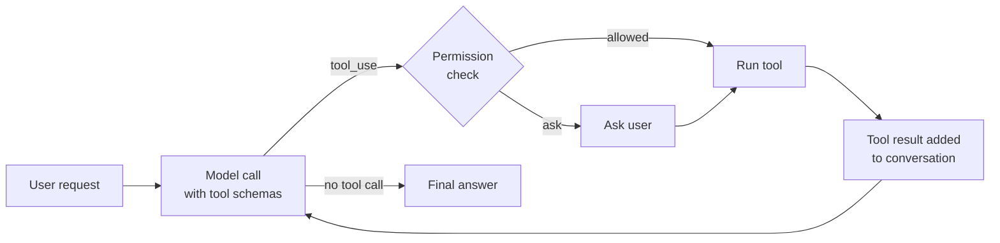
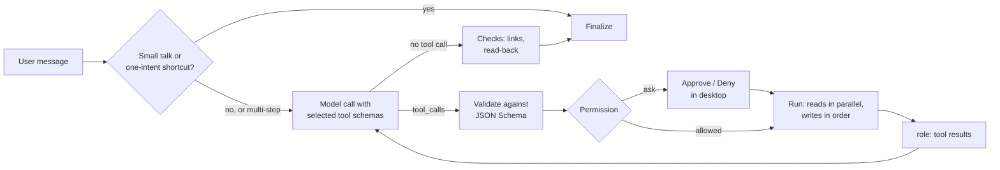
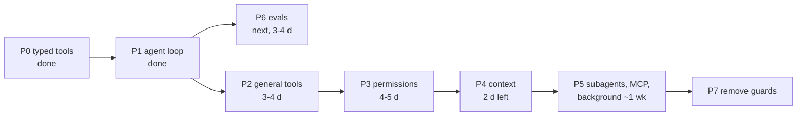

# Luna agent harness: comparison with Claude Code and Codex, and the plan to close the gap

As of 2026-09-23 (updated after phases 0–1 shipped, then after the session-state, eval and router-logging work).

**Bottom line:** Main chat runs on **one general agent loop** with native tool calling, typed tool schemas, many steps per request and parallel read-only calls (phases 0–1). Long conversations now keep a **working state outside the chat** (facts, code written, files) that is re-read every turn, the way Claude Code re-reads files and git (phase 4). A 32-turn architecture/coding eval and a long-context eval run on an isolated backend (phase 6), and routing decisions are logged to train a Laya router (phase 8). Left: general file/shell/git tools in the loop (2), permission modes and hooks (3), subagents, MCP client, background runs (5). The coding agent and crew still run their own loops, now only on explicit or workspace requests.

## Status

| Phase | Status | Notes |
|---|---|---|
| 0. Typed tool layer | **Done** | JSON Schema for all 70 tools, validation with type coercion |
| 1. Agent loop | **Done** | Native tool calling, up to 10 steps, parallel reads, live tool steps in the desktop app |
| 2. General-purpose tools | Not started | Path-confinement bug still open (`startswith`) |
| 3. Permissions, confirmations, hooks | Partly | Loop pauses for approval (120 s) with Approve/Deny in the desktop app; no modes, patterns or hooks yet |
| 4. Context for long runs | **Mostly done** | Conversation working state (facts, code artifacts, files) pinned every turn; `search_conversation`; long pastes condensed by relevance; reliable rolling summary. Left: `LUNA.md` |
| 5. Subagents, MCP client, background | Not started | |
| 6. Evaluation harness | **Done (v1)** | `python -m tests.evals.run`: 20-scenario suite, deep-thread (32 turns) and long-context suites on an isolated backend. Left: per-model tracking |
| 7. Remove workarounds | Not started | Guards still run as a safety net; the promised-save guard now ignores code and long answers |
| 8. Learned router (Laya) | **Shadow mode** | Probe beats the rules on coding_agent (0.75 vs 0.17 F1) and save_request (0.82 vs 0.70) on 80 held-out messages; runs beside the rules on real turns and logs disagreements. Next: more labels, then switch those two |

Notes on sources: the Claude Code and Codex details come from their public docs and behaviour as I know them (mid-2026), not a fresh lookup. The Luna details come from reading this repo.

---

## 1. How the loops differ

**Claude Code / Codex:** one loop, repeated until the model stops asking for tools.

**Luna chat now:** the same loop, behind the fast shortcuts.

**Luna chat before (still the fallback):** one generate, one tool call parsed out of the text, no second model step. It runs when `AGENT_LOOP_ENABLED=false` or the provider isn't Ollama. The model never saw a tool result and decided what to do next, so "search, then save a task" couldn't happen in one request.

---

## 2. Full comparison

| Area | Claude Code | Codex CLI | Luna (after phases 0–1) | Gap |
|---|---|---|---|---|
| **Agent loop** | Multi-step loop until no tool call | Multi-step loop until no tool call | **Done:** chat runs model → tools → model up to 10 steps ([agent_loop/loop.py](../backend/services/agent_loop/loop.py)). Coding agent, crew and enterprise workflow still have their own loops | Small: other agents not merged yet |
| **Tool calling format** | Native API tool use (typed JSON schema) | Native function calling | **Done:** Ollama native `tools` / `tool_calls` / `role: tool` ([tool_calling.py](../backend/services/llm/tool_calling.py)); calls written as text are recovered. Other providers fall back to the text protocol | Small: Anthropic/OpenAI native not wired |
| **Tool definitions** | JSON Schema per tool | JSON Schema per tool | **Done:** JSON Schema for all 70 tools ([tool_schemas.py](../backend/services/tool_schemas.py)), validated with `jsonschema` before running | None |
| **Parallel tool calls** | Yes (several reads at once) | Yes | **Done:** consecutive read-only calls run concurrently; writes run alone, in order; results return in call order | None |
| **Core coding tools** | Read, Write, Edit, Glob, Grep, Bash, NotebookEdit | shell, apply_patch, read | `code_read/edit/write/list/search/delete/rename`, `code_run_shell` ([coding/tools.py](../backend/services/coding/tools.py)) | Small: exists, coding agent only |
| **Web tools** | WebSearch, WebFetch | web search (configurable) | `web_search`, `web_fetch`, `browser_read`, skill runtime, grounding | **Luna ahead**: grounding and link checks |
| **Tool loading** | Deferred tools + ToolSearch | All tools | **Done:** 14 core tools (~1.5k tokens) + topic groups loaded by keyword + `tool_search` for the rest (all 70 would be ~5.9k tokens) | None |
| **Task list / progress** | TodoWrite tool the model maintains | Plan tool | Live tool steps in the desktop app; plan events in coding agent; `task_planner` only on the fallback path | Medium: no todo tool |
| **Permissions** | Modes (default / accept edits / plan / bypass), allow/deny rules with patterns (e.g. `Bash(npm test:*)`) | Approval modes (untrusted / on-request / never) + sandbox | allow / confirm / block per tool by risk level ([permission_manager.py](../backend/services/permission_manager.py)); no patterns, no modes | Medium |
| **Sandbox** | Permission prompts; optional OS sandbox for Bash | OS sandbox (Seatbelt / Landlock / Windows sandbox), network off by default | Path check with `startswith` (prefix bug: `workspace2` passes); `shell=True`; no OS sandbox | **Large** for shell safety |
| **Confirmation flow** | Blocks and asks, then continues | Blocks and asks, then continues | Loop: pauses up to 120 s, Approve/Deny in the desktop app, a denial is reported to the model. Old path: 30 s then skip. Coding agent: still skips | Small |
| **Hooks** | PreToolUse, PostToolUse, Stop, SessionStart, etc. | Limited / notify hooks | None | Medium |
| **Project instructions** | CLAUDE.md (user, project, folder) | AGENTS.md | Luna's own system prompt + personality; no per-project file for the agent | Small |
| **Context management** | Auto-compaction, clears old tool results; state re-read from files/git | Auto-compaction | `fit_context` + rolling summary (16k window); append-only facts + code artifacts pinned every turn; `search_conversation` over the whole chat; long pastes condensed by relevance; tool results clipped in the loop | Small: no mid-run compaction |
| **Memory** | CLAUDE.md + auto memory files | AGENTS.md, some memory | `memory_manager`, `memory_graph`, fact extraction, MCP memory server | **Luna ahead** |
| **Skills** | Skills (SKILL.md), slash commands, plugins | Prompts / skills | `server/skills/*` + `skill.json` + `skill_runtime`, `use_skill` tool | Even |
| **MCP** | Client: uses any MCP server | Client | **Server only**: exposes six MCP servers, can't consume others ([server/mcp/](../backend/mcp/)) | Medium |
| **Subagents** | Task/Agent tool: separate context, returns a summary | Limited | `agents/crew.py` (planner/critic/writer roles, parallel), separate from chat | Medium: exists, not a tool |
| **Background / long tasks** | Background shells, background agents | Cloud tasks in containers | Scheduler jobs; nothing for long agent runs | Medium |
| **Checkpoints / undo** | Rewind file edits and conversation | Git-based | Enterprise workflow uses a git branch; no undo for workspace edits | Medium |
| **Headless / SDK** | `claude -p`, Agent SDK | `codex exec` | REST + SSE API, CLI (`interfaces/cli/luna.mjs`) | Even |
| **Verification of actions** | Model reads tool output and self-corrects | Same | Model reads tool output in the loop, **plus** read-back for tasks/events on all three save paths (tool calls, `[TASK]`/`[EVENT]` tags, background fact extractor); link grounding against tool results | Luna: harness-level checks, good for small models |
| **Evaluation harness** | Internal evals | Internal evals | Unit tests with fake models; `benchmark.py` (latency / success) | **Large**: no scenario evals |
| **Model** | Frontier cloud model | Frontier cloud model | Local `qwen2.5:7b` on a 12 GB RTX 3060 (cloud providers optional) | Structural: plan must fit a 7–14B model |

### Luna's six separate "agent" implementations

| # | Where | What it does | Status |
|---|---|---|---|
| 1 | `chat_pipeline/` | One generate, one tool | **Replaced by the agent loop** (kept as fallback) |
| 2 | `coding/agent.py` | Real ReAct loop, coding tools only | Still separate; merge in phase 2 |
| 3 | `task_planner.py` | Regex spots a "complex" request, runs one step per *user message* | **Off when the loop runs**; fallback path only |
| 4 | `planner/service.py` | Plan, execute, critique, recover | Still separate |
| 5 | `agents/crew.py` | Multi-role crew, parallel subtasks | Still separate; becomes a subagent in phase 5 |
| 6 | `enterprise_workflow.py` | Fixed bug-fix pipeline (context, code, tests, PR) | Still separate; becomes a skill in phase 5 |

1 and 3 are merged. Next: the coding agent joins the loop (phase 2), crew becomes a subagent tool and the enterprise workflow a skill (phase 5).

---

## 3. Where Luna is already ahead

- **Runs locally and privately**: Ollama, local vision (qwen2.5vl), local speech-to-text (faster-whisper), local embeddings.
- **Personal assistant surface**: voice with push-to-talk, desktop app, reminders that fire, calendar, activity tracking, Spotify and system controls.
- **Long-term personal memory**: fact extraction, memory graph, rolling conversation summaries.
- **Grounded web answers**: link liveness checks, stripping made-up links, skill-specific search rules.
- **Harness-side verification**: saves are read back from the database, and the loop's final answer is checked for links that no tool returned. This matters more with small models and stays.

---

## 4. Implementation plan

Each phase ships on its own and leaves Luna working. Phases 1–3 are the core. Rough effort assumes one developer.

### Phase 0: typed tool layer (done)

Every tool has a JSON Schema that both the model and the harness use.

Built:
- [tool_schemas.py](../backend/services/tool_schemas.py): a schema for each of the 70 tools (types, required fields, enums, ranges, descriptions) and a `READ_ONLY_TOOLS` set used for parallel runs.
- [tool_registry.py](../backend/services/tool_registry.py): `ToolDef` gains `input_schema` and `read_only`; `model_tool_spec()` gives the function-calling format; `validate_tool_args()` checks calls with `jsonschema`, converts `"60"` to `60` and `"true"` to `true`, drops unknown keys and empty optional values, and returns readable errors.
- `jsonschema==4.26.0` pinned in `server/requirements.txt`.

Not done from the original plan (moved to phase 2):
- A typed `ToolResult {ok, content, data, error_kind}` from every tool. The loop still judges success from the result text (`Error:` / `failed:` prefixes). System controls now return `Error: ...` on failure instead of a `(False, msg)` tuple.
- Merging `coding/tools.py` into the registry: coding tools have schemas but stay out of chat.

### Phase 1: the agent loop (done for chat)

Built:
- [agent_loop/loop.py](../backend/services/agent_loop/loop.py) `AgentLoop`:
  - Ollama `/api/chat` with `tools`, streamed; structured `tool_calls` in, `role: tool` messages back ([tool_calling.py](../backend/services/llm/tool_calling.py)).
  - Repeats until the model answers without tools, or `AGENT_MAX_STEPS` (10), then asks for a final answer with no tools.
  - **Parallel calls**: consecutive read-only calls run with `asyncio.gather`; a write runs alone, in the order the model gave; results go back in call order.
  - Order per call: validate against the schema, then permission check (Approve/Deny, `AGENT_CONFIRM_TIMEOUT_S` = 120), then run. Invalid arguments, denials and exceptions go back to the model as tool results; nothing crashes the request.
  - Identical repeat calls return "you already made this call" instead of running twice.
  - If the model announces an action ("let me check") without calling a tool, it gets one nudge to call it.
  - Tool results capped at `AGENT_TOOL_RESULT_CHARS` (6,000); older results become stubs when the run outgrows the window.
  - `create_task` / `create_event` descriptions carry the current local date ("tonight = 2026-09-23"). This fixed "tonight" being saved as tomorrow.
  - Web lookups (`web_search`, `use_skill`) still go through the skill runtime; result cards are re-attached to the final answer.
- [agent_loop/tool_selection.py](../backend/services/agent_loop/tool_selection.py): 14 core tools always loaded, topic groups by keyword, `tool_search` loads the rest (Claude Code's deferred-tool idea). `web_research` and `code_*` are excluded from chat.
- [agent_loop/routing.py](../backend/services/agent_loop/routing.py): requests with several steps skip the one-intent dispatch shortcuts and go to the loop.
- Pipeline ([stages.py](../backend/services/chat_pipeline/stages.py)): the loop replaces `generate -> process_tools` when the provider is Ollama and `AGENT_LOOP_ENABLED` is true. Small talk, dispatch shortcuts, coding agent and crew stay in front. Events stream live: `tool_call`, `tool_result`, `confirmation_required`, `confirmation_resolved`, `agent_done`, and `message_part` tokens for voice/CLI.
- After the loop, `finish_plain_reply` runs the existing checks: unverified links (tool results count as sources), the promised-save guard (skipped when a save tool ran), and `[TASK]`/`[EVENT]` tags saved and read back.
- System prompt: native mode says *when* to use tools (`get_tool_rules_for_prompt`), not a JSON syntax. Task/event and audio instructions name the tools.
- Desktop ([agent-steps.js](../desktop-app/src/renderer/agent-steps.js)): live step rows ("Searching the web", "Adding a task") that collapse to "Used N tools", and Approve/Deny cards for risky tools.
- The background fact extractor now saves through the same `save_task` / `save_event` path (UTC, reworded titles match). It was a third save path creating duplicates in local time.
- Tests: [test_agent_loop.py](../tests/tools/test_agent_loop.py) has 16 tests (schemas, validation, text-call recovery, multi-step, parallel timing and order, invalid args, repeats, step budget, nudge, declined confirmation, `tool_search`, routing). `test_reminders.py` covers the extractor path.

Not done from the original plan:
- Anthropic / OpenAI native tool calling (those providers use the old text path).
- The coding agent still runs its own loop (phase 2).
- Steps aren't saved with the message, so they disappear when a chat is reloaded.

### What the live tests showed

Run against the real backend and `qwen2.5:7b` on 2026-09-23:

| Request | Result |
|---|---|
| "current volume and brightness?" | 2 reads in one step, in parallel |
| Task tomorrow 9 am + meeting Friday 3 pm | 2 writes in order, correct dates, both read back |
| "latest F1 winner, then task to watch highlights tonight 9 pm" | `use_skill` then `create_task` across 2 steps, saved for today 9 PM |
| Download a PDF to the workspace | Paused for approval; unanswered, so declined and reported |
| "I have a meeting at 6 p.m. Make sure to add that." | Updated the existing meeting; no duplicate |

Still weak:
- **Skipped tool calls.** Asked for brightness again, the model answered from memory without calling the tool, despite the rule. Evals (phase 6) and a qwen3 8B comparison should address this.
- **Thin answers.** The model tends to say "Got it" without repeating the result. The rules now ask for it, which helped but isn't reliable.
- **Latency.** 8-36 s per request on the 3060; a lookup plus a save takes about 25-36 s.

### Phase 2: general-purpose tools (3–4 days)

Goal: the tool set Claude Code / Codex rely on, available in the main loop.

- `read_file`, `write_file`, `edit_file` (exact-string replace), `glob`, `grep`, `bash` over a configured workspace root.
- `todo_write`: the model keeps a visible task list (replaces plan events). Show it in the desktop UI.
- Fix path confinement: use `Path.resolve().is_relative_to(root)` instead of `startswith`.
- `bash`: no `shell=True` for allow-listed commands; timeout, output cap, and working directory fixed to the workspace.
- Git tools: `git_status`, `git_diff`, `git_commit` (risky), plus existing `github_create_pr`.

Files: `coding/tools.py` → `tools/files.py`, `tools/shell.py`, `tools/git.py`, `tools/todo.py`.
Done when: the loop can fix a failing test in a sample repo (read, edit, run tests, report) without the separate coding agent.

### Phase 3: permissions, confirmations, hooks (4–5 days)

Goal: safe enough to let the loop edit files and run commands.

- **Modes**: `ask` (default), `auto-edit` (file edits allowed, shell asks), `plan` (read-only tools only), `auto` (everything except dangerous). Selectable per conversation in the UI.
- **Pattern rules** in `data/permissions.json`: e.g. `bash: allow ["npm test*", "pytest*", "git status"]`, `deny ["rm -rf*", "git push --force*"]`.
- **Blocking confirmations** (mostly done in phase 1): the loop pauses on `confirmation_required` for up to 120 s and resumes on Approve/Deny in the desktop app. Left: "always allow this", and the same flow in the coding agent.
- **Hooks**: `pre_tool` and `post_tool` handlers (Python callables or shell commands in config). Used for audit logging, blocking paths, and auto-formatting after edits.
- Audit every external read and write (already partly done in `executor.py`).

Files: `permission_manager.py`, new `agent_loop/hooks.py`, `routers/chat.py` (confirm endpoint), desktop confirm UI.
Done when: tests cover allow / deny / ask per mode and pattern, and a denied `rm -rf` never runs.

### Phase 4: context for long runs (mostly done)

Goal: a 30-turn conversation (or a 30-step run) keeps its facts and its code.

**Why Claude Code holds up and Luna didn't.** Claude Code's real state lives outside the conversation (files, git, CLAUDE.md, the todo list), so after compaction it just looks again. Luna's state (decisions, code it wrote) lived only in the chat, so a lossy summary lost it. Fix: keep the conversation's working state outside the chat and re-read it every turn.

Built:
- [session_state.py](../backend/services/session_state.py) + `conversation_artifacts` table:
  - **Facts and decisions**: after each rolling summary, a separate extraction appends new facts ("Cache: Redis, 24-hour TTL", "Code generation: counter-based (assistant's recommendation)"). Append-only and de-duplicated, never rewritten. In the deep-thread eval the rewritten summary dropped exactly these; the append-only list kept them.
  - **Code artifacts**: every code block Luna writes, with its turn and function/class/table/route names.
  - **Pinned block every turn**: facts, an index of code written so far, the full code the user refers to (by name or "the encoder you wrote earlier"), attached files.
- **`search_conversation` tool**: searches the whole conversation, including turns out of the window (Luna's "read the file again").
- **Long pastes**: condensed by relevance (start and end kept verbatim, middle chunks ranked by embeddings + keywords) instead of middle-clipped.
- **Rolling summary**: triggers on the stored message count (the old counter raced and never hit its multiple of 10) and keeps exact facts.
- **Real prompt size logged** per model step (`prompt_eval_count`), with a warning if the window is full.

- Inside the loop, clip old tool results to a short stub once they're no longer needed (done in phase 1: oldest first, only when the run outgrows the window).
- Auto-compact: when a run passes about 75% of the window, summarise earlier steps with the existing rolling-summary code.
- Project instruction file: load `LUNA.md` (or `AGENTS.md` / `CLAUDE.md`) from the workspace root into the system prompt, like CLAUDE.md.

Files: `llm/context_window.py`, `agent_loop/loop.py`, `prompt_builder.py`.
Done when: a synthetic 40-step run stays under the window, and the final answer still cites step-1 facts.

### Phase 5: subagents, MCP client, background runs (1 week)

- **Subagent tool** (`delegate`): runs a fresh loop with its own context and a restricted tool set, and returns only a summary. `crew.py` roles become subagent presets (researcher, coder, critic).
- **MCP client**: connect to any MCP server listed in config and expose its tools in the registry. Luna's own servers, and third-party ones like Jira or Notion, then work without custom connectors.
- **Background runs**: long loops run as jobs that survive the chat stream closing. Progress goes to the desktop UI; the result is saved to the conversation.
- **Checkpoints**: snapshot files before edits; `/undo` restores them.
- Re-express `enterprise_workflow.py` as a skill (`server/skills/bugfix-workflow/SKILL.md`) that the loop follows, with the fixed steps kept as a checklist.

Done when: the CLAUDE.md target workflow (bug → Jira → PR → Slack → fix → tests → PR) runs from one message, with each step visible and write steps confirmed.

### Phase 6: evaluation harness (started)

Built: [tests/evals/](../tests/evals/). `python -m tests.evals.run [--suite deep|long]` snapshots the data, starts an **isolated backend** (port 8898, own data dir, no background jobs, own shared-conversation state), runs the suites and prints a scorecard.
- `deep_thread.py`: 32-turn architecture + coding thread (URL shortener "Snip"); probes decisions at turns 9/24/32, the turn-5 function name at 16, and the turn-6 recommendation at 32; flags empty replies, refusals, off-stack answers, crew/coding-agent routing.
- `long_context.py`: facts planted at turn 1 and probed after 8/18/28 filler turns, a recall-the-2nd-topic probe, a late tool call, needle-in-a-haystack at ~8k and ~20k tokens.

Never run evals against the live backend: every message becomes the shared active conversation, which the desktop app follows (this happened once and mixed a test into a real chat).

Results on `qwen3-8b` (RTX 3060), first run vs after the fixes in this document:

| Check | First run | After fixes |
|---|---|---|
| Long: facts after 8 / 18 / 28 filler turns / at the end | 0/4 each | 4/4 each |
| Long: needle at ~8k / ~20k tokens | missed / missed | found / found |
| Long: late tool call ("volume right now?") | answered from memory | called `get_volume` |
| Long: "what was the second topic?" | ✗ | ✗ (fixed after: earlier requests listed in order) |
| Deep: decisions at turn 9 | 4/4 | 4/4 |
| Deep: function written at turn 5, asked at 16 | ✓ | ✓ |
| Deep: name + TTL at turn 24 | 0/2 | 0/2 (a "remind me" guard overwrote the answer; fixed after) |
| Deep: decisions + turn-6 recommendation at 32 | 3/5 | 5/5 |
| Deep: empty replies | 3 | 1 (fixed after: empty answers are retried) |

What the runs uncovered, in order:
- Crew mode hijacked recall questions ("**code** word" + "quick **check**") and answered with no history.
- Coding questions went to the separate coding agent without context fitting; now only workspace file work does.
- The model wrote code to files (and waited 120 s for approval) or created calendar events for "add an endpoint"; file and task tools now load only when the conversation is about files or scheduling.
- The "promised save" guard read code comments ("created_at is set … task") as a claim and replaced whole answers; it now ignores code and long answers, and in the agent loop only corrects explicit false claims.
- Auto-saved "preferred examples" taught the model to answer device questions from memory; the pairs were wiped and replaced by curated, per-message style examples.
- The rolling summary rewrote old facts and topics away; facts are now append-only and earlier requests are listed verbatim.

Still to do:

- `tests/evals/`: YAML scenarios with a user message (or several turns) plus checks, e.g. DB state, tool calls made, tool calls *not* made, reply contains or omits certain text.
- Runs against the live backend and real model. Outputs a pass/fail report plus tool-call traces. Run it before every model or prompt change.
- Seed it with the bugs from this project: reminder at 6 PM, reworded duplicate titles, "tonight" saved as tomorrow, device questions answered from memory, multi-step requests taken by shortcuts, fake links, "Sure, let's check" with no search, date questions, `/research` gating, file Q&A, new-chat isolation.
- Start from the live-test driver used for phase 1: send messages to a fresh conversation, print tool calls and results, check the database.
- Track pass rate per model (qwen2.5:7b vs qwen3 8B vs qwen2.5-coder:14b) to choose the default.

Done when: `npm run eval` produces a report, and the 20 seed scenarios pass on the chosen model.

### Phase 7: remove the workarounds (ongoing)

Once evals show the loop handles them, remove the regex guards: `_promises_lookup`, `_ensure_promised_action`, bracket fallbacks, `ADD_REQUEST_RE` / `CLAIM_RE`. Keep read-back verification and link grounding permanently; they're cheap and catch real errors.

### Phase 8: learned router with Laya (shadow mode)

[Laya](https://huggingface.co/convaiinnovations/laya) is an open (Apache-2.0) 421M encoder that answers structured questions about a short text (~0.3 s on CPU here). It fits Luna's small routing decisions, which are regexes today and caused several of this project's bugs. Files: [utilities/laya/](../utilities/laya/).

Done, in order:
1. **Decision log**: every turn's route, tools and rule decisions, plus correction/repeat feedback ([decision_log.py](../backend/services/decision_log.py)).
2. **Labelled data**: an 80-message held-out test set (`routing_benchmark.jsonl`, never trained on) and a 215-message training set (`routing_train.jsonl`), hand-labelled for crew / coding_agent / save_request / multi_step.
3. **Scoring** (F1 on the held-out 80):

| Decision | Regex (before) | Regex (now) | Laya zero-shot | Laya probe (215 train) |
|---|---|---|---|---|
| crew | 0.80 | **0.91** | 0.67 | 0.67 |
| coding_agent | 0.11 | 0.17 | 0.32 | **0.75** |
| save_request | 0.70 | 0.70 | 0.72 | **0.82** |
| multi_step | 0.75 | 0.75 | 0.29 | **0.77** |

   The `laya` package has no fine-tuning API, so "probe" = Laya's encoder frozen + a logistic-regression head per decision (`train_probe.py`). Zero-shot is weak, as published.
4. **Shadow mode** ([laya_shadow.py](../backend/services/laya_shadow.py)): after each reply, Laya scores coding_agent / save_request / multi_step and a `shadow` line records both answers; routing is untouched. `python -m utilities.laya.shadow_report` lists disagreements. First 22 eval turns: Laya right on 3 of 6 disagreements, including "make it 5 pm instead" (a save the rules missed and that failed a scenario).

Next: label disagreements from real use into `routing_train.jsonl`, retrain, and switch coding_agent and save_request to Laya once they clearly beat the rules on real traffic. Crew stays a keyword rule (explicit asks always contain the keyword). Install: `pip install -r utilities/laya/requirements.txt` (model cached in `.hf-cache` on E:).

### Order and timeline

About 3–4 weeks left for one developer. Evals come first, so later phases are measured rather than eyeballed.

---

## 5. Model choice on this machine (RTX 3060, 12 GB)

| Model (installed) | Tool calling | Fits 12 GB with 16k context | Use |
|---|---|---|---|
| `qwen2.5:7b` | Yes (native) | Yes | Current default; baseline for evals |
| `qwen3-8b` (Q4_K_M) | Yes (native, stronger multi-step) | Yes | Likely best default for the loop; confirm with evals |
| `qwen2.5-coder:14b` | Yes | Tight (context may need to drop to ~8k) | Coding subagent |
| `qwen3-coder:30b` | Yes | No: partial CPU offload, slow | Only for background coding runs |
| Cloud (Claude / OpenAI) | Yes | n/a | Optional "hard task" mode through the same loop |

The loop should be model-agnostic, and evals (phase 6) decide the default.

---

## 6. Risks and open questions

- **Small models skip or misuse tools.** Seen live: answering device state from memory, and weak final answers. In place: `max_steps`, repeat detection, the announce-without-call nudge, the date anchor in time-bearing tools. Still needed: evals and a model comparison.
- **Shell safety on Windows.** Codex-style OS sandboxing isn't available here without extra work. Until then: `ask` mode by default, pattern allow-lists, workspace-confined cwd, no network tools in `plan` mode.
- **Latency.** Each loop step is a model call; measured 8–36 s per request. Small-talk and one-intent shortcuts stay in front of the loop.
- **VRAM contention.** The chat model, vision model and whisper share 12 GB. The loop should use one model at a time; Ollama's `keep_alive` settings need tuning.
- **Decided:** the desktop app shows steps live and collapses them into one "Used N tools" row when the answer arrives. Open: should steps be saved with the message so they survive a reload?
- **Open question:** Anthropic / OpenAI native tool calling, so cloud mode uses the loop too.
- **Open question:** workspace scope. Is the loop limited to `data/workspace/` by default, with an explicit "open project" to point it at a repo like `E:\Luna`?
